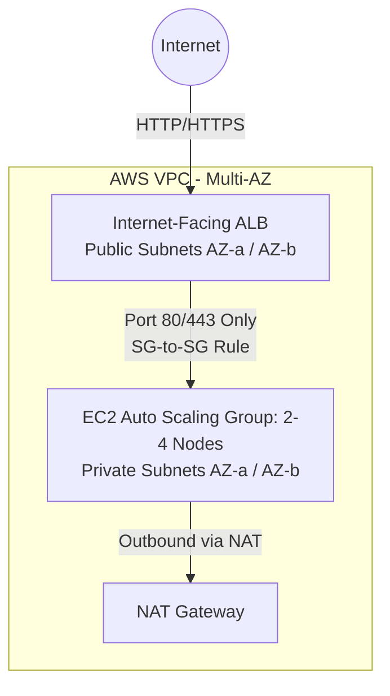

# Hardened Multi-Tier AWS Infrastructure with Terraform

[](https://github.com/egekarabey35/aws-terraform-hardened-infra/actions/workflows/security-scan.yml)


Multi-AZ AWS infrastructure provisioned declaratively with Terraform (`vpc.tf`, `security_groups.tf`, `compute.tf`). Designed around least-privilege networking, instance metadata hardening, and automated CI/CD static analysis (`tflint`, `tfsec`).

---

## Architecture Diagram



### Repository Structure
* `vpc.tf` – VPC, 2 Public & 2 Private Subnets across two Availability Zones, Internet Gateway, NAT Gateway, and isolated Route Tables.
* `security_groups.tf` – Strict Security Group chaining (ALB SG -> Compute SG) with restricted ingress/egress rules.
* `compute.tf` – EC2 Launch Template (IMDSv2 enforced, encrypted EBS), Auto Scaling Group (2–4 capacity), and Application Load Balancer.
* `variables.tf` / `outputs.tf` / `versions.tf` – Parameterized inputs, infrastructure outputs, and pinned provider versions.

---

## Security Hardening & Architecture Decisions

* **Network Isolation:** EC2 instances run strictly in private subnets with `associate_public_ip_address = false`. Direct internet ingress is blocked; traffic must pass through the Application Load Balancer.
* **IMDSv2 Enforcement:** Launch Templates enforce `http_tokens = "required"` and `http_put_response_hop_limit = 1` to mitigate SSRF-based IAM credential extraction.
* **Security Group Chaining:** Application nodes only accept inbound traffic originating from the ALB Security Group ID rather than broad CIDR blocks, minimizing lateral movement.
* **CI/CD Security Gates:** GitHub Actions runs `terraform fmt -check`, `tflint`, and `tfsec` on every push and pull request to catch misconfigurations prior to deployment.

---

## FinOps & Cost Breakdown (Estimated Monthly Baseline)

While compute instances utilize burstable `t3.micro` types (eligible for the 750 hrs/month AWS Free Tier on new accounts), always-on networking components incur fixed hourly costs:

| AWS Resource | Configuration | Est. Monthly Cost (us-east-1) |
| :--- | :--- | :--- |
| **Application Load Balancer (ALB)** | 1x Internet-facing ALB (~730 hrs + minimal LCU) | ~$16.50 |
| **NAT Gateway / Elastic IP** | 1x NAT Gateway (~730 hrs, lab data volume) | ~$32.85 |
| **EC2 Compute (ASG: 2x `t3.micro`)** | 1x covered by Free Tier (750 hrs), 1x On-Demand | ~$7.60 |
| **EBS GP3 Storage** | Encrypted root volumes (within 30 GB Free Tier) | $0.00 |
| **Total Estimated Lab Run-Rate** | **If left running 24/7 for 30 days** | **~$56.95 / mo** *(or ~$24/mo without NAT GW)* |

> **FinOps Practice:** To avoid idle hourly charges from the ALB and NAT Gateway during development, environments are provisioned ephemerally for validation and torn down via `terraform destroy`.

---

## Usage

```bash
terraform init
terraform fmt -check
terraform validate
terraform plan -out=tfplan
terraform apply tfplan
```
